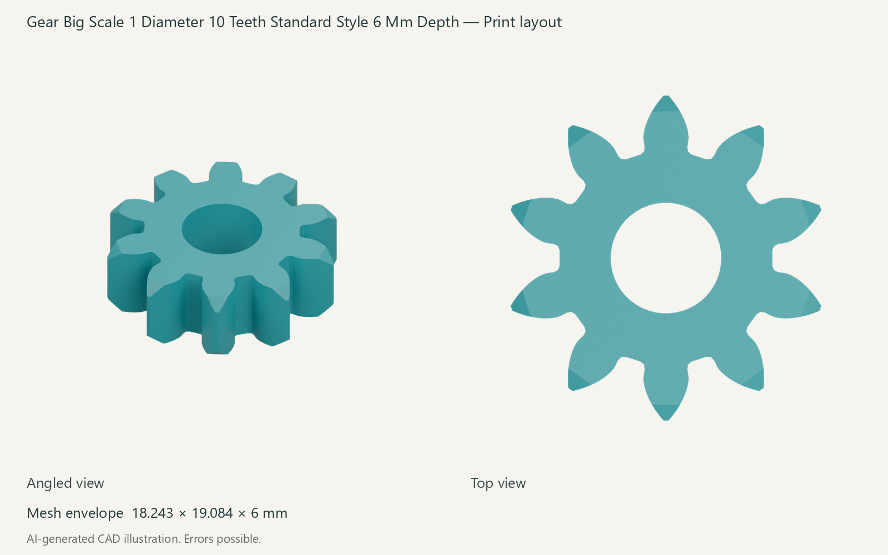

<!-- oobb-presentation:start -->
# OOBB gears

AI-generated images and instructions. Errors possible.

## Summary

Parametric OOBB gears in big and little scales, including standard, flange, clam-shell, bearing and bevel variants.

This is an entirely AI-generated coding project. The generated outputs are included and usually work, but the main purpose of publishing it is to give others a starting point for modifying the project with their own AI tools.

[Example part](parts/oobb_part_gear_big_scale_1_diameter_10_teeth_standard_style_6_mm_depth/)

## Details

This catalogue contains **50 records**. [Browse OOBB navigation](navigation_oobb/oobb/part/gear/).

Each part has one canonical folder, its full OOMP ID and complete metadata. Navigation links open folders; use GitHub’s file pane to browse the available files.

[Build and maintenance guide](CATALOGUE_BUILD.md)

## Parts

Choose the gear scale, tooth count, style and depth. The exported print layout may contain several components for a single variant.

## Assembly

Use the selected variant’s geometry and metadata to check the mating gear, shaft and bearing requirements. Existing component-specific fit and bevel examples remain available.
<!-- oobb-presentation:end -->
