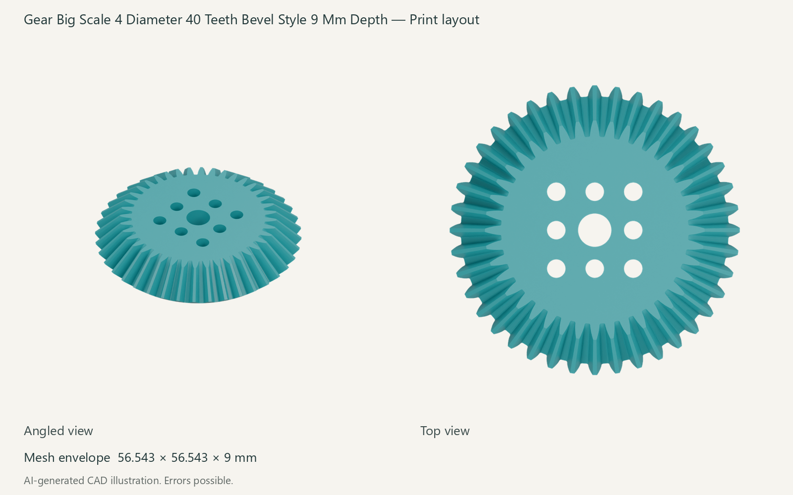

<!-- oobb-presentation:start -->
# Oobb Part Gear Big Scale 4 Diameter 40 Teeth Bevel Style 9 Mm Depth

AI-generated images and instructions. Errors possible.

## Summary

Parametric OOBB gears in big and little scales, including standard, flange, clam-shell, bearing and bevel variants.

This is an entirely AI-generated coding project. The generated outputs are included and usually work, but the main purpose of publishing it is to give others a starting point for modifying the project with their own AI tools.



## Details

**Full OOMP ID:** `oobb_part_gear_big_scale_4_diameter_40_teeth_bevel_style_9_mm_depth`

[Part folder](../../../../../../../../../parts/oobb_part_gear_big_scale_4_diameter_40_teeth_bevel_style_9_mm_depth/) · [OOBB navigation](../../../../../../../../)

| Field | Value |
| --- | --- |
| Backlash | 0.2 |
| Base Chamfer | 0.8 |
| Bevel Profile | flat_top_ramped_underside |
| Cone Distance | 42.426406871192846 |
| Depth | 9 |
| Diameter | 60.0 |
| Diameter Outer | 62.121320343559645 |
| Diameter Root | 57.34834957055045 |
| Face Width | 15.62138662044437 |
| Mate Teeth | 40 |
| Module | 1.5 |
| Oobb Name | gear_big_bevel_style |
| Pitch Angle | 45 |
| Pressure Angle | 20 |
| Scale | big |
| Shaft Angle | 90 |
| Style | bevel |
| Teeth | 40 |
| Underside Angle | 45 |
| Taxonomy | oobb / part / gear / big_scale / 4_diameter / 40_teeth / bevel_style / 9_mm_depth |

<details>
<summary>Full part details: all working.yaml fields</summary>

```yaml
backlash: 0.2
base_chamfer: 0.8
bevel_profile: flat_top_ramped_underside
cone_distance: 42.426406871192846
depth: 9
diameter: 60.0
diameter_outer: 62.121320343559645
diameter_root: 57.34834957055045
directory: parts/oobb_part_gear_big_scale_4_diameter_40_teeth_bevel_style_9_mm_depth
face_width: 15.62138662044437
id: oobb_part_gear_big_scale_4_diameter_40_teeth_bevel_style_9_mm_depth
id_oobb: oobb_part_gear_big_scale_4_diameter_40_teeth_bevel_style_9_mm_depth
kwargs:
  backlash: 0.2
  base_chamfer: 0.8
  bevel_profile: flat_top_ramped_underside
  cone_distance: 42.426406871192846
  depth: 9
  diameter: 60.0
  diameter_outer: 62.121320343559645
  diameter_root: 57.34834957055045
  face_width: 15.62138662044437
  filter: ''
  generate_stl: false
  mate_teeth: 40
  modes:
  - 3dpr
  module: 1.5
  navigation: false
  oobb_name: gear_big_bevel_style
  oomp_description_extra: 9_depth
  oomp_description_main: gear_big_bevel_style_60_0_diameter
  oomp_mode: project
  oomp_run: false
  overwrite: true
  pitch_angle: 45
  pressure_angle: 20
  scale: big
  shaft_angle: 90
  style: bevel
  teeth: 40
  typ: fast
  type: C:\gh\oomlout_oobb_gear_version_5_gear_big_bevel_style
  underside_angle: 45
mate_teeth: 40
module: 1.5
name: Oobb Part Gear Big Scale 4 Diameter 40 Teeth Bevel Style 9 Mm Depth
name_proper: Oobb Part Gear Big Scale 4 Diameter 40 Teeth Bevel Style 9 Mm Depth
notes: Straight 1:1 bevel pair. Mate with identical scale, tooth count and depth.
  Shared pitch-cone apex; see examples/bevel_gear_90_degree_pair.scad.
oobb_details:
  backlash: 0.2
  base_chamfer: 0.8
  bevel_profile: flat_top_ramped_underside
  cone_distance: 42.426406871192846
  depth: 9
  diameter: 60.0
  diameter_outer: 62.121320343559645
  diameter_root: 57.34834957055045
  face_width: 15.62138662044437
  mate_teeth: 40
  module: 1.5
  oobb_name: gear_big_bevel_style
  pitch_angle: 45
  pressure_angle: 20
  scale: big
  shaft_angle: 90
  style: bevel
  teeth: 40
  underside_angle: 45
oobb_name: gear_big_bevel_style
pitch_angle: 45
pressure_angle: 20
project_name: C:\gh\oomlout_oobb_gear_version_5
scale: big
shaft_angle: 90
style: bevel
taxonomy_1: oobb
taxonomy_10: ''
taxonomy_11: ''
taxonomy_12: ''
taxonomy_13: ''
taxonomy_14: ''
taxonomy_15: ''
taxonomy_2: part
taxonomy_3: gear
taxonomy_4: big_scale
taxonomy_5: 4_diameter
taxonomy_6: 40_teeth
taxonomy_7: bevel_style
taxonomy_8: 9_mm_depth
taxonomy_9: ''
teeth: 40
underside_angle: 45
```

</details>

## Parts

Choose the gear scale, tooth count, style and depth. The exported print layout may contain several components for a single variant.

## Assembly

Use the selected variant’s geometry and metadata to check the mating gear, shaft and bearing requirements. Existing component-specific fit and bevel examples remain available.
<!-- oobb-presentation:end -->
