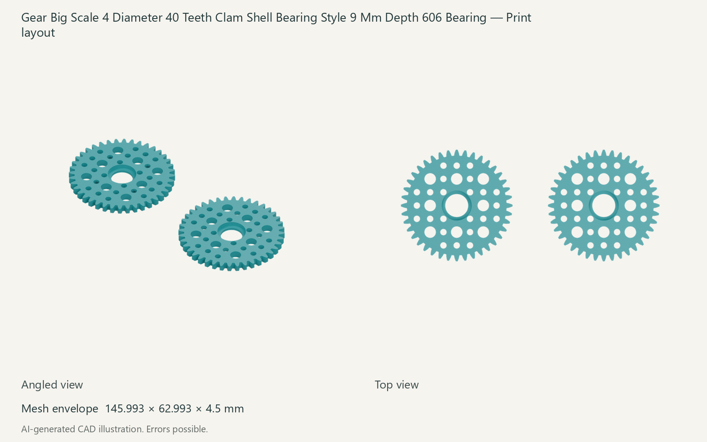

<!-- oobb-presentation:start -->
# Oobb Part Gear Big Scale 4 Diameter 40 Teeth Clam Shell Bearing Style 9 Mm Depth 606 Bearing

AI-generated images and instructions. Errors possible.

## Summary

Parametric OOBB gears in big and little scales, including standard, flange, clam-shell, bearing and bevel variants.

This is an entirely AI-generated coding project. The generated outputs are included and usually work, but the main purpose of publishing it is to give others a starting point for modifying the project with their own AI tools.



## Details

**Full OOMP ID:** `oobb_part_gear_big_scale_4_diameter_40_teeth_clam_shell_bearing_style_9_mm_depth_606_bearing`

[Part folder](../../../../../../../../../../parts/oobb_part_gear_big_scale_4_diameter_40_teeth_clam_shell_bearing_style_9_mm_depth_606_bearing/) · [OOBB navigation](../../../../../../../../../)

| Field | Value |
| --- | --- |
| Bearing | 606 |
| Depth | 9 |
| Diameter | 60.0 |
| Diameter Outer | 63.0 |
| Diameter Root | 56.25 |
| Module | 1.5 |
| Oobb Name | gear_big_clam_shell_bearing_style |
| Pressure Angle | 20 |
| Scale | big |
| Style | clam_shell_bearing |
| Teeth | 40 |
| Taxonomy | oobb / part / gear / big_scale / 4_diameter / 40_teeth / clam_shell_bearing_style / 9_mm_depth / 606_bearing |

<details>
<summary>Full part details: all working.yaml fields</summary>

```yaml
bearing: '606'
bip_39_2_word_array:
- romance
- manage
bip_39_2_word_no_space: romancemanage
bip_39_2_word_space: romance manage
bip_39_2_word_underscore: romance_manage
bip_39_3_word_array:
- romance
- manage
- virus
bip_39_3_word_no_space: romancemanagevirus
bip_39_3_word_space: romance manage virus
bip_39_3_word_underscore: romance_manage_virus
bip_39_full_array:
- romance
- manage
- virus
- armor
- aim
- drink
- often
- pull
- outdoor
- matrix
- wedding
- before
bip_39_full_no_space: romancemanagevirusarmoraimdrinkoftenpulloutdoormatrixweddingbefore
bip_39_full_space: romance manage virus armor aim drink often pull outdoor matrix
  wedding before
bip_39_full_underscore: romance_manage_virus_armor_aim_drink_often_pull_outdoor_matrix_wedding_before
depth: 9
diameter: 60.0
diameter_outer: 63.0
diameter_root: 56.25
directory: parts/oobb_part_gear_big_scale_4_diameter_40_teeth_clam_shell_bearing_style_9_mm_depth_606_bearing
generate_stl: false
id: oobb_part_gear_big_scale_4_diameter_40_teeth_clam_shell_bearing_style_9_mm_depth_606_bearing
id_no_class: oobb_part_gear_big_scale_4_diameter_40_teeth_clam_shell_bearing_style_9_mm_depth_606_bearing
id_no_size: oobb_part_gear_big_scale_4_diameter_40_teeth_clam_shell_bearing_style_9_mm_depth_606_bearing
id_no_type: oobb_part_gear_big_scale_4_diameter_40_teeth_clam_shell_bearing_style_9_mm_depth_606_bearing
id_oobb: oobb_part_gear_big_scale_4_diameter_40_teeth_clam_shell_bearing_style_9_mm_depth_606_bearing
kwargs:
  bearing: '606'
  depth: 9
  diameter: 60.0
  diameter_outer: 63.0
  diameter_root: 56.25
  filter: ''
  generate_stl: false
  modes:
  - 3dpr
  module: 1.5
  navigation: false
  oobb_name: gear_big_clam_shell_bearing_style
  oomp_description_extra: 606_bearing_9_depth
  oomp_description_main: gear_big_clam_shell_bearing_style_60_0_diameter
  oomp_mode: project
  oomp_run: false
  overwrite: true
  pressure_angle: 20
  scale: big
  style: clam_shell_bearing
  teeth: 40
  typ: fast
  type: default_gear_big_clam_shell_bearing_style
link_github: https://github.com/oomlout/oomlout_oomp_version_1_messy/tree/main/parts/oobb_part_gear_big_scale_4_diameter_40_teeth_clam_shell_bearing_style_9_mm_depth_606_bearing
link_main: https://github.com/oomlout/oomlout_oomp_version_1_messy/tree/main/parts/oobb_part_gear_big_scale_4_diameter_40_teeth_clam_shell_bearing_style_9_mm_depth_606_bearing
link_redirect: https://github.com/oomlout/oomlout_oomp_version_1_messy/tree/main/parts/oobb_part_gear_big_scale_4_diameter_40_teeth_clam_shell_bearing_style_9_mm_depth_606_bearing
md5: bb90dfd205f05486266d6a9d3127e38a
md5_10: bb90dfd205
md5_10_upper: BB90DFD205
md5_5: bb90d
md5_5_upper: BB90D
md5_6: bb90df
md5_6_alpha: 7bgtb
md5_6_alpha_upper: 7BGTB
md5_6_upper: BB90DF
module: 1.5
name: Oobb Part Gear Big Scale 4 Diameter 40 Teeth Clam Shell Bearing Style 9 Mm Depth
  606 Bearing
name_no_class: Oobb Part Gear Big Scale 4 Diameter 40 Teeth Clam Shell Bearing Style
  9 Mm Depth 606 Bearing
name_no_size: Oobb Part Gear Big Scale 4 Diameter 40 Teeth Clam Shell Bearing Style
  9 Mm Depth 606 Bearing
name_no_type: Oobb Part Gear Big Scale 4 Diameter 40 Teeth Clam Shell Bearing Style
  9 Mm Depth 606 Bearing
name_proper: Oobb Part Gear Big Scale 4 Diameter 40 Teeth Clam Shell Bearing Style
  9 Mm Depth 606 Bearing
name_space: oobb part gear big scale 4 diameter 40 teeth clam shell bearing style
  9 mm depth 606 bearing
name_upper: OOBB PART GEAR BIG SCALE 4 DIAMETER 40 TEETH CLAM SHELL BEARING STYLE
  9 MM DEPTH 606 BEARING
oobb_details:
  bearing: '606'
  depth: 9
  diameter: 60.0
  diameter_outer: 63.0
  diameter_root: 56.25
  module: 1.5
  oobb_name: gear_big_clam_shell_bearing_style
  pressure_angle: 20
  scale: big
  style: clam_shell_bearing
  teeth: 40
oobb_name: gear_big_clam_shell_bearing_style
oomlout_ai_roboclick_1:
  actions:
  - command: new_chat
    description: step_1_create_icon
  - command: ai_query
    delay: '120'
    mode_ai_wait: slow
    text: 'This is a context-loading and exploration step for a laser-cuttable mascot
      logo. Take your time and think expansively before answering. Explore multiple
      mascot directions, compare several line-art approaches, stress-test them for
      charm, readability, manufacturability, and overall polish, and explain everything
      that would be useful for the next step. The goal here is not brevity. The goal
      is to surface strong options, useful observations, and a well-reasoned direction
      for a square, single-colour, black-on-white mascot logo drawing that is charming,
      original, cute, polished, and instantly readable at small size.


      Creative direction:

      - Invent one central mascot concept based on the theme, but push beyond generic
      clip art. The mascot should feel witty, memorable, and slightly surprising while
      still being cute and simple.

      - Favor an adorable line-drawing character with a clear face, pose, and identity.
      Anthropomorphize only as much as needed for charm and readability.

      - Supporting elements and text are allowed and can be important when they help
      define the identity, dimensions, category, mood, or story of the logo.

      - Favor iconic themed props, symbols, labels, and shape cues over random decoration.
      Every element should help the logo read faster and feel more complete.

      - Think in stages before writing: concept search, line-language search, simplification,
      and final refinement. Prefer the idea that stays most legible after simplification.

      - Deliberately look for a concept that feels specific to the theme rather than
      generic kawaii branding.

      - Keep the cute details genuinely sweet and lovable: soft expressions, appealing
      proportions, simple cheeks, tiny hands or feet only if they help, and charming
      gesture choices.

      - Search for a direction that feels like a designed branded icon rather than
      a loose doodle page.

      - Make all parts of the image feel like they were designed by one illustrator
      in one visual family, with consistent shape logic, line language, facial styling,
      spacing, and proportion choices.

      - Favor rounded geometric simplification, clear negative space, gentle symmetry
      or balance where useful, and a visual hierarchy where the mascot leads and the
      supporting details and text reinforce.


      Format and manufacturing constraints:

      - Pure black artwork on a pure white background only.

      - No grey, no shading, no gradients, no halftones, no texture, no color, no
      transparency, and no background scene.

      - Prefer line drawing over large filled black areas. Use clean outlines and
      sparse interior detail instead of heavy solid shapes.

      - Design for laser cutting: lines should be confident and durable rather than
      hairline-thin; details should be simple; no dense crosshatching; and any islands
      should be connected if the design depends on physical continuity.

      - Keep the artwork centered in a square composition with comfortable margins
      and a clean airy overall read.

      - The drawing should feel cute, open, and light rather than dark, chunky, or
      posterized.

      - If text is used, it should be bold, simple, highly legible, and visually integrated
      with the illustration.

      - Border-like framing is allowed only if it strengthens the logo as a clean
      badge or label shape rather than making it feel boxed in.

      - Prioritize readability, cuteness, manufacturability, clarity, cohesion, and
      polish over detail.


      What to include in your response:

      - Several candidate mascot directions for the theme, with notes on why each
      could work.

      - Observations about line clarity, readability at small size, cuteness, and
      laser-cut safety.

      - Notes on what details should be simplified, merged, thickened, connected,
      or removed to keep the drawing light and appealing.

      - Suggestions for supporting motifs and text treatments only where they genuinely
      improve the idea.

      - Observations about what makes the composition feel polished, cohesive, brandable,
      and visually unified rather than random or clip-art-like.

      - A recommended direction, with an explanation of why it is strongest.

      - One strong final image-generation prompt at the end, ready for later use.


      Response style:

      - Explain your reasoning clearly and include all useful detail.

      - It is fine to use structure, bullets, short sections, and comparisons if that
      helps clarity.

      - The final prompt should explicitly say the image is square and black on white.

      '
  - command: ai_query
    delay: '120'
    mode_ai_wait: slow
    text: 'Now use the exploration work to develop the direction for this theme: an
      image of oobb part gear big scale 4 diameter 40 teeth clam shell bearing style
      9 mm depth 606 bearing make Oobb Part Gear Big Scale 4 Diameter 40 Teeth Clam
      Shell Bearing Style 9 Mm Depth 606 Bearing cute


      Take your time and search outward before narrowing down. Flesh the theme out
      beyond its obvious first interpretation. Explore multiple mascot angles, visual
      metaphors, poses, supporting motifs, text treatments, and line-drawing approaches,
      and explain what becomes more interesting, more readable, cuter, more cohesive,
      or more manufacturable as you develop the idea. Make it more creatively specific
      than the theme name alone while staying laser-cut safe.


      What to do:

      - Explore a healthy range of possible directions, not just the first few obvious
      ones.

      - Search for specific, memorable, and theme-native ideas rather than generic
      cute branding.

      - Compare different mascot interpretations, poses, prop choices, supporting
      motifs, and label or badge text treatments where relevant.

      - Compare different outline and interior-line strategies, especially ones that
      avoid large dark filled areas.

      - Discuss what helps or hurts the drawing at small size.

      - Call out what should be simplified, thickened, connected, merged, or removed
      for laser cutting.

      - Surface tradeoffs between charm, cuteness, clarity, uniqueness, and manufacturability.

      - Favor directions that feel sweet, lovable, and visually light. Avoid details
      that make the mascot feel fussy, stern, generic, or overdesigned.

      - Favor directions where the mascot, supporting details, and text feel like
      one designed system rather than separate assets placed next to each other.

      - Look for ways to make the composition feel more polished, premium, badge-like,
      and visually intentional without losing warmth.

      - Recommend the strongest direction only after the exploration feels well developed.

      - End with one polished final image-generation prompt paragraph for the recommended
      direction.


      Response style:

      - Explain everything that seems useful for the next step.

      - It is good to be expansive here; do not compress the thinking prematurely.

      - Structured notes, comparisons, bullets, and short sections are welcome if
      they help clarity.

      - The final prompt should explicitly say the image is square and black on white.

      '
  - command: ai_query
    delay: '120'
    mode_ai_wait: slow
    text: Generate the image take all the time you need
  - command: save_image_generated
    file_name: initial_generated_icon.png
    mode_ai_wait: slow
  - command: close_tab
  file_test: initial_generated_icon.png
oomlout_ai_roboclick_2:
  actions:
  - command: text_jinja_template
    convert_to_pdf: false
    convert_to_png: false
    dict_data:
      bearing: '606'
      depth: 9
      diameter: 60.0
      diameter_outer: 63.0
      diameter_root: 56.25
      directory: parts\oobb_part_gear_big_scale_4_diameter_40_teeth_clam_shell_bearing_style_9_mm_depth_606_bearing
      module: 1.5
      name: oobb_part_gear_big_scale_4_diameter_40_teeth_clam_shell_bearing_style_9_mm_depth_606_bearing
      name_proper: Oobb Part Gear Big Scale 4 Diameter 40 Teeth Clam Shell Bearing
        Style 9 Mm Depth 606 Bearing
      name_space: oobb part gear big scale 4 diameter 40 teeth clam shell bearing
        style 9 mm depth 606 bearing
      name_upper: OOBB PART GEAR BIG SCALE 4 DIAMETER 40 TEETH CLAM SHELL BEARING
        STYLE 9 MM DEPTH 606 BEARING
      oobb_details:
        bearing: '606'
        depth: 9
        diameter: 60.0
        diameter_outer: 63.0
        diameter_root: 56.25
        module: 1.5
        oobb_name: gear_big_clam_shell_bearing_style
        pressure_angle: 20
        scale: big
        style: clam_shell_bearing
        teeth: 40
      oomlout_ai_roboclick_1:
        actions:
        - command: new_chat
          description: step_1_create_icon
        - command: ai_query
          delay: '120'
          mode_ai_wait: slow
          text: 'This is a context-loading and exploration step for a laser-cuttable
            mascot logo. Take your time and think expansively before answering. Explore
            multiple mascot directions, compare several line-art approaches, stress-test
            them for charm, readability, manufacturability, and overall polish, and
            explain everything that would be useful for the next step. The goal here
            is not brevity. The goal is to surface strong options, useful observations,
            and a well-reasoned direction for a square, single-colour, black-on-white
            mascot logo drawing that is charming, original, cute, polished, and instantly
            readable at small size.


            Creative direction:

            - Invent one central mascot concept based on the theme, but push beyond
            generic clip art. The mascot should feel witty, memorable, and slightly
            surprising while still being cute and simple.

            - Favor an adorable line-drawing character with a clear face, pose, and
            identity. Anthropomorphize only as much as needed for charm and readability.

            - Supporting elements and text are allowed and can be important when they
            help define the identity, dimensions, category, mood, or story of the
            logo.

            - Favor iconic themed props, symbols, labels, and shape cues over random
            decoration. Every element should help the logo read faster and feel more
            complete.

            - Think in stages before writing: concept search, line-language search,
            simplification, and final refinement. Prefer the idea that stays most
            legible after simplification.

            - Deliberately look for a concept that feels specific to the theme rather
            than generic kawaii branding.

            - Keep the cute details genuinely sweet and lovable: soft expressions,
            appealing proportions, simple cheeks, tiny hands or feet only if they
            help, and charming gesture choices.

            - Search for a direction that feels like a designed branded icon rather
            than a loose doodle page.

            - Make all parts of the image feel like they were designed by one illustrator
            in one visual family, with consistent shape logic, line language, facial
            styling, spacing, and proportion choices.

            - Favor rounded geometric simplification, clear negative space, gentle
            symmetry or balance where useful, and a visual hierarchy where the mascot
            leads and the supporting details and text reinforce.


            Format and manufacturing constraints:

            - Pure black artwork on a pure white background only.

            - No grey, no shading, no gradients, no halftones, no texture, no color,
            no transparency, and no background scene.

            - Prefer line drawing over large filled black areas. Use clean outlines
            and sparse interior detail instead of heavy solid shapes.

            - Design for laser cutting: lines should be confident and durable rather
            than hairline-thin; details should be simple; no dense crosshatching;
            and any islands should be connected if the design depends on physical
            continuity.

            - Keep the artwork centered in a square composition with comfortable margins
            and a clean airy overall read.

            - The drawing should feel cute, open, and light rather than dark, chunky,
            or posterized.

            - If text is used, it should be bold, simple, highly legible, and visually
            integrated with the illustration.

            - Border-like framing is allowed only if it strengthens the logo as a
            clean badge or label shape rather than making it feel boxed in.

            - Prioritize readability, cuteness, manufacturability, clarity, cohesion,
            and polish over detail.


            What to include in your response:

            - Several candidate mascot directions for the theme, with notes on why
            each could work.

            - Observations about line clarity, readability at small size, cuteness,
            and laser-cut safety.

            - Notes on what details should be simplified, merged, thickened, connected,
            or removed to keep the drawing light and appealing.

            - Suggestions for supporting motifs and text treatments only where they
            genuinely improve the idea.

            - Observations about what makes the composition feel polished, cohesive,
            brandable, and visually unified rather than random or clip-art-like.

            - A recommended direction, with an explanation of why it is strongest.

            - One strong final image-generation prompt at the end, ready for later
            use.


            Response style:

            - Explain your reasoning clearly and include all useful detail.

            - It is fine to use structure, bullets, short sections, and comparisons
            if that helps clarity.

            - The final prompt should explicitly say the image is square and black
            on white.

            '
        - command: ai_query
          delay: '120'
          mode_ai_wait: slow
          text: 'Now use the exploration work to develop the direction for this theme:
            an image of oobb part gear big scale 4 diameter 40 teeth clam shell bearing
            style 9 mm depth 606 bearing make Oobb Part Gear Big Scale 4 Diameter
            40 Teeth Clam Shell Bearing Style 9 Mm Depth 606 Bearing cute


            Take your time and search outward before narrowing down. Flesh the theme
            out beyond its obvious first interpretation. Explore multiple mascot angles,
            visual metaphors, poses, supporting motifs, text treatments, and line-drawing
            approaches, and explain what becomes more interesting, more readable,
            cuter, more cohesive, or more manufacturable as you develop the idea.
            Make it more creatively specific than the theme name alone while staying
            laser-cut safe.


            What to do:

            - Explore a healthy range of possible directions, not just the first few
            obvious ones.

            - Search for specific, memorable, and theme-native ideas rather than generic
            cute branding.

            - Compare different mascot interpretations, poses, prop choices, supporting
            motifs, and label or badge text treatments where relevant.

            - Compare different outline and interior-line strategies, especially ones
            that avoid large dark filled areas.

            - Discuss what helps or hurts the drawing at small size.

            - Call out what should be simplified, thickened, connected, merged, or
            removed for laser cutting.

            - Surface tradeoffs between charm, cuteness, clarity, uniqueness, and
            manufacturability.

            - Favor directions that feel sweet, lovable, and visually light. Avoid
            details that make the mascot feel fussy, stern, generic, or overdesigned.

            - Favor directions where the mascot, supporting details, and text feel
            like one designed system rather than separate assets placed next to each
            other.

            - Look for ways to make the composition feel more polished, premium, badge-like,
            and visually intentional without losing warmth.

            - Recommend the strongest direction only after the exploration feels well
            developed.

            - End with one polished final image-generation prompt paragraph for the
            recommended direction.


            Response style:

            - Explain everything that seems useful for the next step.

            - It is good to be expansive here; do not compress the thinking prematurely.

            - Structured notes, comparisons, bullets, and short sections are welcome
            if they help clarity.

            - The final prompt should explicitly say the image is square and black
            on white.

            '
        - command: ai_query
          delay: '120'
          mode_ai_wait: slow
          text: Generate the image take all the time you need
        - command: save_image_generated
          file_name: initial_generated_icon.png
          mode_ai_wait: slow
        - command: close_tab
        file_test: initial_generated_icon.png
      pressure_angle: 20
      scale: big
      style: clam_shell_bearing
      taxonomy_1: oobb
      taxonomy_10: ''
      taxonomy_11: ''
      taxonomy_12: ''
      taxonomy_13: ''
      taxonomy_14: ''
      taxonomy_15: ''
      taxonomy_2: part
      taxonomy_3: gear
      taxonomy_4: big_scale
      taxonomy_5: 4_diameter
      taxonomy_6: 40_teeth
      taxonomy_7: clam_shell_bearing_style
      taxonomy_8: 9_mm_depth
      taxonomy_9: 606_bearing
      teeth: 40
      url_chat: https://chatgpt.com/c/6a447d5f-9c20-83ed-afbb-812435c9d779
    file_output: label_oomp.svg
    file_template: source_file\template_jinja\template_jinja_label_oomlout_76_2_mm_50_8_mm\working.svg.j2
    search_and_replace: []
  file_test: label_oomp.pdf
oomp_key: oomp_oobb_part_gear_big_scale_4_diameter_40_teeth_clam_shell_bearing_style_9_mm_depth_606_bearing
pressure_angle: 20
project_name: C:\gh\oomlout_oobb_gear_version_5
run_action: true
run_oomp: true
run_oomp_populate: true
run_scad: false
scale: big
style: clam_shell_bearing
taxonomy_1: oobb
taxonomy_10: ''
taxonomy_11: ''
taxonomy_12: ''
taxonomy_13: ''
taxonomy_14: ''
taxonomy_15: ''
taxonomy_1_capital: Oobb
taxonomy_1_first_letter: o
taxonomy_1_first_letter_upper: O
taxonomy_1_length_1: o
taxonomy_1_length_2: oo
taxonomy_1_length_3: oob
taxonomy_1_length_4: oobb
taxonomy_1_length_5: oobb
taxonomy_1_upper: OOBB
taxonomy_1_upper_length_1: O
taxonomy_1_upper_length_2: OO
taxonomy_1_upper_length_3: OOB
taxonomy_1_upper_length_4: OOBB
taxonomy_1_upper_length_5: OOBB
taxonomy_2: part
taxonomy_2_capital: Part
taxonomy_2_first_letter: p
taxonomy_2_first_letter_upper: P
taxonomy_2_length_1: p
taxonomy_2_length_2: pa
taxonomy_2_length_3: par
taxonomy_2_length_4: part
taxonomy_2_length_5: part
taxonomy_2_upper: PART
taxonomy_2_upper_length_1: P
taxonomy_2_upper_length_2: PA
taxonomy_2_upper_length_3: PAR
taxonomy_2_upper_length_4: PART
taxonomy_2_upper_length_5: PART
taxonomy_3: gear
taxonomy_3_capital: Gear
taxonomy_3_first_letter: g
taxonomy_3_first_letter_upper: G
taxonomy_3_length_1: g
taxonomy_3_length_2: ge
taxonomy_3_length_3: gea
taxonomy_3_length_4: gear
taxonomy_3_length_5: gear
taxonomy_3_upper: GEAR
taxonomy_3_upper_length_1: G
taxonomy_3_upper_length_2: GE
taxonomy_3_upper_length_3: GEA
taxonomy_3_upper_length_4: GEAR
taxonomy_3_upper_length_5: GEAR
taxonomy_4: big_scale
taxonomy_4_capital: Big Scale
taxonomy_4_first_letter: b
taxonomy_4_first_letter_upper: B
taxonomy_4_length_1: b
taxonomy_4_length_2: bi
taxonomy_4_length_3: big
taxonomy_4_length_4: big_
taxonomy_4_length_5: big_s
taxonomy_4_upper: BIG_SCALE
taxonomy_4_upper_length_1: B
taxonomy_4_upper_length_2: BI
taxonomy_4_upper_length_3: BIG
taxonomy_4_upper_length_4: BIG_
taxonomy_4_upper_length_5: BIG_S
taxonomy_5: 4_diameter
taxonomy_5_capital: 4 Diameter
taxonomy_5_first_letter: '4'
taxonomy_5_first_letter_upper: '4'
taxonomy_5_length_1: '4'
taxonomy_5_length_2: '4_'
taxonomy_5_length_3: 4_d
taxonomy_5_length_4: 4_di
taxonomy_5_length_5: 4_dia
taxonomy_5_upper: 4_DIAMETER
taxonomy_5_upper_length_1: '4'
taxonomy_5_upper_length_2: '4_'
taxonomy_5_upper_length_3: 4_D
taxonomy_5_upper_length_4: 4_DI
taxonomy_5_upper_length_5: 4_DIA
taxonomy_6: 40_teeth
taxonomy_6_capital: 40 Teeth
taxonomy_6_first_letter: '4'
taxonomy_6_first_letter_upper: '4'
taxonomy_6_length_1: '4'
taxonomy_6_length_2: '40'
taxonomy_6_length_3: '40_'
taxonomy_6_length_4: 40_t
taxonomy_6_length_5: 40_te
taxonomy_6_upper: 40_TEETH
taxonomy_6_upper_length_1: '4'
taxonomy_6_upper_length_2: '40'
taxonomy_6_upper_length_3: '40_'
taxonomy_6_upper_length_4: 40_T
taxonomy_6_upper_length_5: 40_TE
taxonomy_7: clam_shell_bearing_style
taxonomy_7_capital: Clam Shell Bearing Style
taxonomy_7_first_letter: c
taxonomy_7_first_letter_upper: C
taxonomy_7_length_1: c
taxonomy_7_length_2: cl
taxonomy_7_length_3: cla
taxonomy_7_length_4: clam
taxonomy_7_length_5: clam_
taxonomy_7_upper: CLAM_SHELL_BEARING_STYLE
taxonomy_7_upper_length_1: C
taxonomy_7_upper_length_2: CL
taxonomy_7_upper_length_3: CLA
taxonomy_7_upper_length_4: CLAM
taxonomy_7_upper_length_5: CLAM_
taxonomy_8: 9_mm_depth
taxonomy_8_capital: 9 mm Depth
taxonomy_8_first_letter: '9'
taxonomy_8_first_letter_upper: '9'
taxonomy_8_length_1: '9'
taxonomy_8_length_2: '9_'
taxonomy_8_length_3: 9_m
taxonomy_8_length_4: 9_mm
taxonomy_8_length_5: 9_mm_
taxonomy_8_upper: 9_MM_DEPTH
taxonomy_8_upper_length_1: '9'
taxonomy_8_upper_length_2: '9_'
taxonomy_8_upper_length_3: 9_M
taxonomy_8_upper_length_4: 9_MM
taxonomy_8_upper_length_5: 9_MM_
taxonomy_9: 606_bearing
taxonomy_9_capital: 606 Bearing
taxonomy_9_first_letter: '6'
taxonomy_9_first_letter_upper: '6'
taxonomy_9_length_1: '6'
taxonomy_9_length_2: '60'
taxonomy_9_length_3: '606'
taxonomy_9_length_4: '606_'
taxonomy_9_length_5: 606_b
taxonomy_9_upper: 606_BEARING
taxonomy_9_upper_length_1: '6'
taxonomy_9_upper_length_2: '60'
taxonomy_9_upper_length_3: '606'
taxonomy_9_upper_length_4: '606_'
taxonomy_9_upper_length_5: 606_B
teeth: 40
url_chat: https://chatgpt.com/c/6a447d5f-9c20-83ed-afbb-812435c9d779
```

</details>

## Parts

Choose the gear scale, tooth count, style and depth. The exported print layout may contain several components for a single variant.

## Assembly

Use the selected variant’s geometry and metadata to check the mating gear, shaft and bearing requirements. Existing component-specific fit and bevel examples remain available.
<!-- oobb-presentation:end -->
