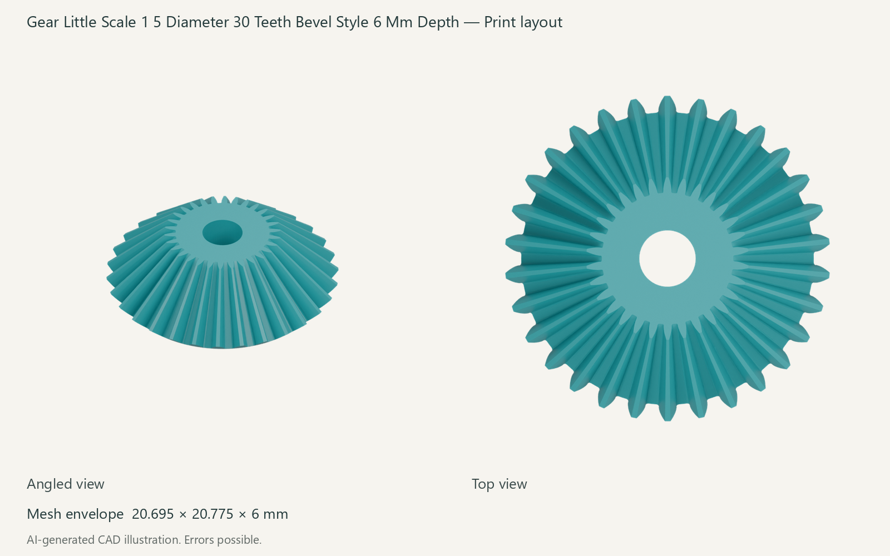

<!-- oobb-presentation:start -->
# Oobb Part Gear Little Scale 1 5 Diameter 30 Teeth Bevel Style 6 Mm Depth

AI-generated images and instructions. Errors possible.

## Summary

Parametric OOBB gears in big and little scales, including standard, flange, clam-shell, bearing and bevel variants.

This is an entirely AI-generated coding project. The generated outputs are included and usually work, but the main purpose of publishing it is to give others a starting point for modifying the project with their own AI tools.



## Details

**Full OOMP ID:** `oobb_part_gear_little_scale_1_5_diameter_30_teeth_bevel_style_6_mm_depth`

[Part folder](./) · [OOBB navigation](../../navigation_oobb/)

| Field | Value |
| --- | --- |
| Backlash | 0.15 |
| Base Chamfer | 0.4 |
| Bevel Profile | flat_top_ramped_underside |
| Cone Distance | 15.909902576697318 |
| Depth | 6 |
| Diameter | 22.5 |
| Diameter Outer | 23.560660171779823 |
| Diameter Root | 21.174174785275223 |
| Face Width | 9.806701084120741 |
| Mate Teeth | 30 |
| Module | 0.75 |
| Oobb Name | gear_little_bevel_style |
| Pitch Angle | 45 |
| Pressure Angle | 20 |
| Scale | little |
| Shaft Angle | 90 |
| Style | bevel |
| Teeth | 30 |
| Underside Angle | 45 |
| Taxonomy | oobb / part / gear / little_scale / 1_5_diameter / 30_teeth / bevel_style / 6_mm_depth |

<details>
<summary>Full part details: all working.yaml fields</summary>

```yaml
backlash: 0.15
base_chamfer: 0.4
bevel_profile: flat_top_ramped_underside
cone_distance: 15.909902576697318
depth: 6
diameter: 22.5
diameter_outer: 23.560660171779823
diameter_root: 21.174174785275223
directory: parts/oobb_part_gear_little_scale_1_5_diameter_30_teeth_bevel_style_6_mm_depth
face_width: 9.806701084120741
id: oobb_part_gear_little_scale_1_5_diameter_30_teeth_bevel_style_6_mm_depth
id_oobb: oobb_part_gear_little_scale_1_5_diameter_30_teeth_bevel_style_6_mm_depth
kwargs:
  backlash: 0.15
  base_chamfer: 0.4
  bevel_profile: flat_top_ramped_underside
  cone_distance: 15.909902576697318
  depth: 6
  diameter: 22.5
  diameter_outer: 23.560660171779823
  diameter_root: 21.174174785275223
  face_width: 9.806701084120741
  filter: ''
  generate_stl: false
  mate_teeth: 30
  modes:
  - 3dpr
  module: 0.75
  navigation: false
  oobb_name: gear_little_bevel_style
  oomp_description_extra: 6_depth
  oomp_description_main: gear_little_bevel_style_22_5_diameter
  oomp_mode: project
  oomp_run: false
  overwrite: true
  pitch_angle: 45
  pressure_angle: 20
  scale: little
  shaft_angle: 90
  style: bevel
  teeth: 30
  typ: fast
  type: C:\gh\oomlout_oobb_gear_version_5_gear_little_bevel_style
  underside_angle: 45
mate_teeth: 30
module: 0.75
name: Oobb Part Gear Little Scale 1 5 Diameter 30 Teeth Bevel Style 6 Mm Depth
name_proper: Oobb Part Gear Little Scale 1 5 Diameter 30 Teeth Bevel Style 6 Mm Depth
notes: Straight 1:1 bevel pair. Mate with identical scale, tooth count and depth.
  Shared pitch-cone apex; see examples/bevel_gear_90_degree_pair.scad.
oobb_details:
  backlash: 0.15
  base_chamfer: 0.4
  bevel_profile: flat_top_ramped_underside
  cone_distance: 15.909902576697318
  depth: 6
  diameter: 22.5
  diameter_outer: 23.560660171779823
  diameter_root: 21.174174785275223
  face_width: 9.806701084120741
  mate_teeth: 30
  module: 0.75
  oobb_name: gear_little_bevel_style
  pitch_angle: 45
  pressure_angle: 20
  scale: little
  shaft_angle: 90
  style: bevel
  teeth: 30
  underside_angle: 45
oobb_name: gear_little_bevel_style
pitch_angle: 45
pressure_angle: 20
project_name: C:\gh\oomlout_oobb_gear_version_5
scale: little
shaft_angle: 90
style: bevel
taxonomy_1: oobb
taxonomy_10: ''
taxonomy_11: ''
taxonomy_12: ''
taxonomy_13: ''
taxonomy_14: ''
taxonomy_15: ''
taxonomy_2: part
taxonomy_3: gear
taxonomy_4: little_scale
taxonomy_5: 1_5_diameter
taxonomy_6: 30_teeth
taxonomy_7: bevel_style
taxonomy_8: 6_mm_depth
taxonomy_9: ''
teeth: 30
underside_angle: 45
```

</details>

## Parts

Choose the gear scale, tooth count, style and depth. The exported print layout may contain several components for a single variant.

## Assembly

Use the selected variant’s geometry and metadata to check the mating gear, shaft and bearing requirements. Existing component-specific fit and bevel examples remain available.
<!-- oobb-presentation:end -->
